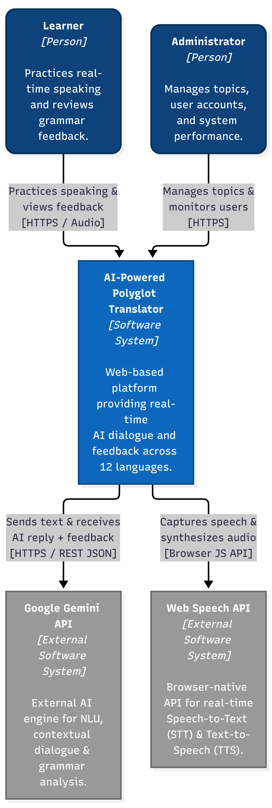
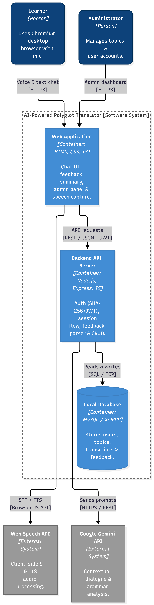
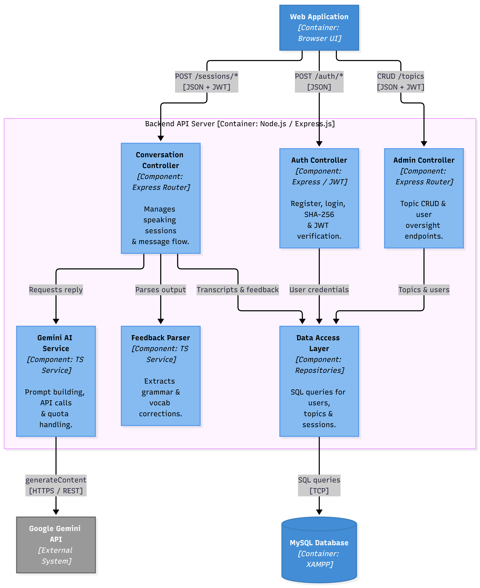
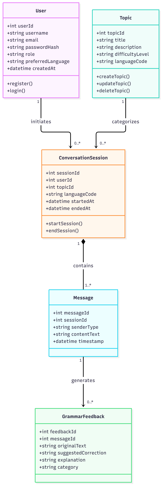
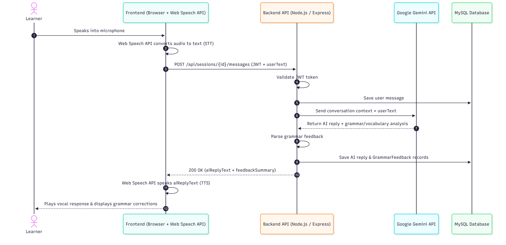

# Software Architecture Documentation — AI-Powered Polyglot Translator

**Team:** Team 25  
**Course:** SENG 321 – Software Engineering Project  
**Sprint:** Sprint 2 (Requirements & Architecture)  
**Author:** Muhammet Yasin Harmandar (Architecture Lead)

---

## 1. Architectural Overview

The **AI-Powered Polyglot Translator** is a web-based language learning platform designed to provide real-time conversational speaking practice and instant grammar/vocabulary feedback across 12 languages. Built under a zero-budget academic constraint, the system adopts a **Layered Client-Server Architecture** backed by a RESTful API, utilizing browser-native speech capabilities and free-tier generative AI services.

### Technology Stack
* **Frontend:** HTML, CSS, TypeScript, Web Speech API (client-side STT & TTS)
* **Backend:** Node.js, Express.js, TypeScript
* **Database:** MySQL (hosted locally via XAMPP)
* **External AI Engine:** Google Gemini API
* **Security:** SHA-256 password hashing and JWT (JSON Web Token) session authentication

---

## 2. C4 Model Views

### 2.1 Level 1 — System Context Diagram
This diagram illustrates the high-level interactions between the platform, its human actors (**Learner** and **Administrator**), and external third-party systems (**Google Gemini API** and **Web Speech API**).

* **Learner:** Interacts with the platform via voice and text to practice speaking and review grammar corrections.
* **Administrator:** Manages conversation topics, oversees user accounts, and monitors system performance.
* **Google Gemini API:** Provides Natural Language Understanding (NLU), contextual dialogue generation, and grammatical error analysis.
* **Web Speech API:** Captures user speech (Speech-to-Text) and synthesizes AI responses into audio (Text-to-Speech) directly within Chromium-based browsers.

---

### 2.2 Level 2 — Container Diagram
The container view decomposes the platform into its three primary runtime units and defines the communication protocols between them.

* **Web Application (Frontend):** Delivers the chat interface, session feedback summaries, and admin dashboard. Offloads audio processing to the client's browser via the Web Speech API to minimize server load and bandwidth usage.
* **Backend API Server:** Exposes RESTful JSON endpoints secured by JWT. Handles authentication, session lifecycle management, prompt orchestration, feedback parsing, and topic CRUD operations.
* **Local Database (MySQL / XAMPP):** Persists user credentials, conversation topics, session transcripts, and structured grammar feedback records.

---

### 2.3 Level 3 — Component Diagram (Backend API)
This diagram zooms into the **Backend API Server** to show the internal modular separation between request routing, business services, and data persistence.

* **Auth Controller:** Manages `/auth/*` routes for user registration, login, SHA-256 hashing, and JWT verification middleware.
* **Conversation Controller:** Handles `/sessions/*` routes, coordinating active speaking sessions and message exchanges.
* **Admin Controller:** Exposes protected CRUD endpoints (`/topics`) for managing conversation topics and user oversight.
* **Gemini AI Service:** Encapsulates prompt construction, HTTPS communication with the Google Gemini API, and free-tier quota/rate-limit handling.
* **Feedback Parser:** Extracts structured grammar and vocabulary corrections from raw AI outputs.
* **Data Access Layer (Repositories):** Abstracts SQL queries for users, topics, sessions, messages, and feedback against the MySQL database.

---

## 3. UML Diagrams

### 3.1 Structural View — UML Class Diagram
The class diagram defines the core domain entities, their attributes, key operations, and relational cardinalities mapped to the MySQL schema.

* A **User** can initiate zero or more **ConversationSession** instances (`1` to `0..*`).
* Each **Topic** categorizes zero or more **ConversationSession** records (`1` to `0..*`).
* A **ConversationSession** has a composition relationship (`1` to `1..*`) with **Message**, ensuring message transcripts belong strictly to their parent session.
* Each **Message** can generate zero or more **GrammarFeedback** entries (`1` to `0..*`) containing original text, suggested corrections, and explanations.

---

### 3.2 Behavioral View — UML Sequence Diagram
The sequence diagram details the end-to-end runtime flow of a single real-time speaking turn, from microphone capture to vocal AI response and grammar feedback display.

1. The **Learner** speaks into the microphone; the browser's **Web Speech API** converts audio to text locally (STT).
2. The **Frontend** sends the transcribed text with a JWT to `POST /api/sessions/{id}/messages`.
3. The **Backend API** validates the token, stores the user message in **MySQL**, and forwards the conversation context to the **Google Gemini API**.
4. **Gemini** returns both a contextual reply and grammar/vocabulary analysis.
5. The **Backend API** parses the feedback, persists the AI reply and `GrammarFeedback` records in **MySQL**, and returns `200 OK` to the client.
6. The **Frontend** plays the AI reply aloud via **Web Speech API** (TTS) and displays the grammar corrections to the learner.

---

## 4. Key Architectural Decisions (ADRs)

| ID | Decision | Rationale | Trade-offs / Constraints |
| :--- | :--- | :--- | :--- |
| **ADR-01** | **Client-Side STT/TTS via Web Speech API** | Eliminates paid audio API costs and reduces backend CPU/bandwidth overhead. | Requires Chromium-based desktop browsers (Chrome/Edge) with microphone permissions; excludes phoneme-level pronunciation scoring. |
| **ADR-02** | **Google Gemini API for Dialogue & Grammar** | Consolidates contextual conversation and grammar analysis into a single free-tier API call per turn. | Subject to free-tier rate limits and occasional latency spikes. |
| **ADR-03** | **Layered REST Architecture (Node.js + Express + TS)** | Strong typing with TypeScript improves maintainability; clear controller-service-repository boundaries simplify unit testing. | Monolithic backend is sufficient for academic scale but would require horizontal scaling for high concurrency. |
| **ADR-04** | **Local MySQL via XAMPP** | Zero-cost relational storage with strict schema enforcement for structured transcripts and feedback logs. | Tied to local deployment environment unless migrated to a cloud RDBMS later. |